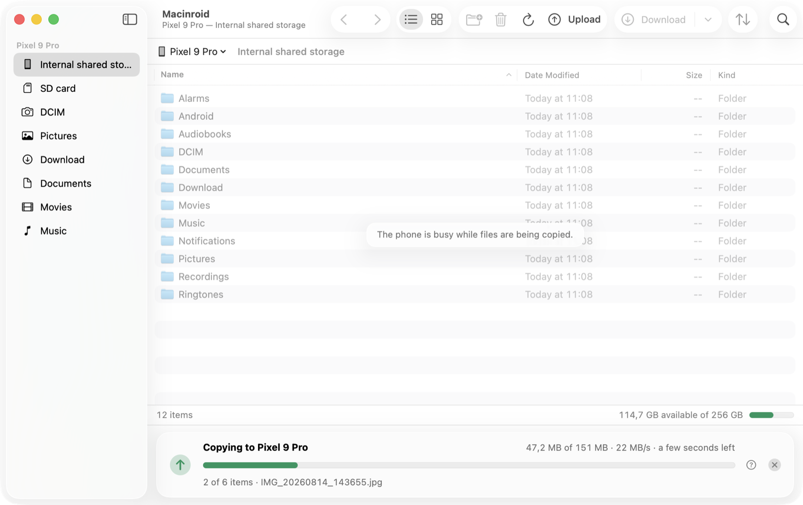

# Macinroid

Macinroid is a native macOS app for moving photos, videos and files between your 
Mac and an Android phone over USB. It's a port of OpenMTP to Swift and SwiftUI. 

Plug in your phone and its storage opens in a window that works the way Finder
does. Drag photos straight to your desktop, drop files onto the phone, or copy
and paste between the two.

<p align="center">
  <picture>
    <source media="(prefers-color-scheme: dark)" srcset="docs/transfer-dark.png">
    
  </picture>
</p>

## Features

- Drag and drop files between the two systems
- Browse the phone's internal storage and SD card from the sidebar.
- Storage capacity at a glance, and the phone's details under *Device Info*.
- Light and dark appearance, and Liquid Glass on macOS 26.
- One universal app for Apple silicon and Intel. No drivers, no extra software.


## Requirements

- macOS 14 Sonoma or later
- An Android phone, and a USB cable that carries data (some only charge)

## Getting started

1. Open Macinroid and connect your phone with a USB cable.
2. Unlock the phone, tap the **Charging this device via USB** notification, and
   under **Use USB for** choose **File Transfer**.
3. If the phone asks **Allow access to phone data?**, tap **Allow**.

The phone's storage appears in the window. If it doesn't, *Help ▸ Macinroid Help*
walks through the usual causes, and *Help ▸ Report a Problem* creates a report
with every USB device macOS sees and a trace of the connection attempt.

## Keyboard shortcuts

| Action | Keys |
|---|---|
| Download to the download folder / to another folder | ⌘D / ⌥⌘D |
| Upload files | ⌘U |
| Copy, to paste in Finder | ⌘C |
| Paste files copied in Finder | ⌘V |
| New folder | ⇧⌘N |
| Rename | Return |
| Delete | ⌘⌫ |
| Open | ⌘O or ⌘↓ |
| Enclosing folder | ⌘↑ |
| Back / Forward | ⌘[ / ⌘] |
| Go to folder | ⇧⌘G |
| Refresh | ⌘R |
| Icons / List | ⌘1 / ⌘2 |
| Show hidden files | ⇧⌘. |
| Device info | ⌘I |
| Cancel the transfer | ⌘. |

*Help ▸ Keyboard Shortcuts* lists them all.

## Building from source

Requirements: Xcode 26. [XcodeGen](https://github.com/yonaskolb/XcodeGen) is only
needed if you change `project.yml`.

```sh
open Macinroid.xcodeproj          # then Run, or:
xcodebuild -project Macinroid.xcodeproj -scheme Macinroid -configuration Release build
xcodebuild -project Macinroid.xcodeproj -scheme Macinroid test
```

The project signs the app to run locally. To distribute it, select your team in
the target's *Signing & Capabilities*. After editing `project.yml`, regenerate the
project with `xcodegen generate`.

To try the app without a phone, launch it with a simulated one:

```sh
open Macinroid.app --args -SimulatedDevice YES
```

The simulated phone is a folder in `~/Library/Caches/Macinroid/SimulatedDevice`,
filled with sample content. Its transfers are slowed down so that progress and
cancelling can be watched.

## How it works

```
Macinroid/
  App/            app entry point, menus
  Core/
    Models/       files, devices, errors, transfers
    Engine/       DeviceBackend: the MTP engine, and the simulated phone
      MTP/        USB transport, MTP sessions, file operations
    Services/     local files, USB hot-plug, settings, logging, updates, problem reports
    State/        AppModel, BrowserModel (one per pane), DeviceSession, TransferCoordinator
  Features/       the interface: main window, file views, transfers, sheets, settings, help
MacinroidTests/
Scripts/          the app icon's generator
```

The interface is SwiftUI, with `NSTableView` and `NSCollectionView` for the file
lists. `AppModel` is the one place where user actions are carried out, so the
menus, the toolbar, the context menus and drag and drop all run the same code.

Android phones share their files over MTP, the Media Transfer Protocol.
Macinroid speaks it itself, in Swift, with no bundled libraries:

- `USBTransport` finds the phone and talks to it through IOUSBHost, macOS's USB
  framework. It reads USB descriptors itself, and selects a phone's
  configuration when macOS has not.
- `MTPSession` handles MTP's transactions: commands, data and responses, in the
  packets USB carries them in, and cancels a transfer by asking the phone to stop.
- `MTPFileSystem` turns MTP's objects and handles into paths, listings and
  transfers of whole folder trees.

The tests run the engine against `FakeMTPDevice`, a simulated phone that speaks
the same wire protocol, down to short and empty USB packets.

## Known limitations

- MTP allows one operation at a time, so the phone's files can't be browsed while
  a transfer is running.
- Finder can only paste files that are already on the Mac, so copying on the
  phone fetches the items to a temporary folder first. For large amounts,
  dragging to Finder or *Download* is quicker.
- Files can't be moved within the phone. Copying within it works by copy and
  paste.
- Cancelling in the middle of a file relies on the phone honouring MTP's cancel
  request; if it does not, Macinroid reconnects, which takes a second or two.
- Dates from the phone are read as local time, which is right when the phone and
  the Mac are set to the same time zone.

## Acknowledgements

Macinroid is a rewrite of [OpenMTP](https://github.com/ganeshrvel/openmtp) by
Ganesh Rathinavel as a native Mac app. Its MTP engine follows the behaviour of the
Go libraries OpenMTP is built on, go-mtpfs and go-mtpx. Their licences are in
[THIRD-PARTY-NOTICES.md](THIRD-PARTY-NOTICES.md).
